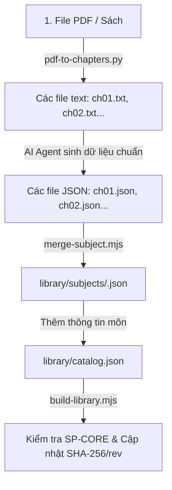

# Hướng Dẫn Tự Động Hoá Dành Cho AI Agent: Chuyển Đổi Sách Giáo Khoa Thành Thư Viện Học Tập (Study Pack)

Tài liệu này được thiết kế để một **AI Coding Agent** (như Antigravity, Claude Code, v.v.) có thể đọc và tự động thực thi 100% quy trình từ khâu trích xuất PDF, biên soạn dữ liệu JSON chuẩn, ghép môn đến cập nhật và build catalog cho ứng dụng học tập **Navel Desk / Sloppy Slop**.

---

## 1. Kiến Trúc Thư Mục Chuẩn

Một workspace chuẩn của hệ thống có cấu trúc như sau:

```text
<project-root>/
├── bleeding_edge.html          # File HTML ứng dụng chứa khối /* SP-CORE-BEGIN */ đến /* SP-CORE-END */
├── index.html                  # (Tuỳ chọn) Bản build chính thức của app
├── tools/
│   ├── pdf-to-chapters.py      # Script tách PDF thành các file văn bản từng chương
│   ├── merge-subject.mjs       # Script kiểm tra và gộp các file chNN.json thành một môn
│   └── build-library.mjs       # Script chuẩn hoá bằng SP-CORE, tính SHA-256, đếm số liệu và cập nhật catalog
└── library/
    ├── catalog.json            # File danh mục quản lí tất cả các môn học
    └── subjects/               # Thư mục chứa các file JSON môn học đã ghép
        ├── math-12.json
        ├── phy-12.json
        └── chem-12.json
```

---

## 2. Quy Trình 4 Bước Tự Động Hoá (End-to-End Pipeline)



---

## 3. Chi Tiết Thực Hiện Từng Bước Dành Cho Agent

### BƯỚC 1: Tách PDF thành văn bản từng chương (`pdf-to-chapters.py`)

1. **Yêu cầu môi trường:** Python 3, thư viện `pypdf`, công cụ `pdftotext` (thuộc bộ Poppler). Đối với sách scan cần thêm `pdftoppm` và `tesseract` (gói ngôn ngữ `vie` cho tiếng Việt).
2. **Lệnh phát hiện cấu trúc chương (Dựa trên Bookmark của PDF):**
   ```bash
   python tools/pdf-to-chapters.py book.pdf out/ --list
   ```
3. **Lệnh trích xuất văn bản:**
   * Nếu PDF có bookmark:
     ```bash
     python tools/pdf-to-chapters.py book.pdf out/ --lang vie
     ```
   * Nếu PDF scan hoặc không có bookmark, chỉ định khoảng trang:
     ```bash
     python tools/pdf-to-chapters.py book.pdf out/ --pages 5-44,45-74,75-86 --lang vie
     ```
4. **Đầu ra:** Tạo ra `out/ch01.txt`, `out/ch02.txt`, ... và `out/chapters.json`.

---

### BƯỚC 2: Biên soạn dữ liệu JSON từng chương (`chNN.json`)

Mỗi chương tương ứng với một tệp JSON (ví dụ `ch01.json`). Agent phải tuân thủ nghiêm ngặt schema dưới đây.

#### Cấu Trúc JSON Chuẩn của một Chương:
```json
{
  "id": "chuong-01-ten-chuong-slug",
  "title": "Chương I. Tên Chương",
  "topics": [
    {
      "id": "bai-01-ten-bai-slug",
      "title": "Bài 1. Tên Bài Học",
      "summary": "Tóm tắt ngắn gọn bài học trong 1-2 câu.",
      "notes": [
        {
          "heading": "Tiêu đề mục kiến thức",
          "points": [
            "Mỗi gạch đầu dòng là một câu đơn mang 1-2 sự kiện, từ khoá quan trọng bọc trong **từ khoá**.",
            "Tập trung giữ số liệu, công thức, định nghĩa chính xác từ sách."
          ]
        }
      ],
      "terms": [
        {
          "term": "Thuật ngữ 1",
          "definition": "Định nghĩa súc tích một câu về thuật ngữ."
        }
      ],
      "cards": [
        {
          "front": "Câu hỏi ngắn hoặc khái niệm cần ghi nhớ?",
          "back": "Câu trả lời cô đọng dưới 30 từ."
        }
      ],
      "questions": [
        {
          "type": "mcq",
          "prompt": "Câu hỏi trắc nghiệm khách quan?",
          "options": ["Lựa chọn A đúng", "Lựa chọn B sai", "Lựa chọn C sai", "Lựa chọn D sai"],
          "answer": 0,
          "explanation": "Giải thích chi tiết vì sao đáp án đó đúng."
        },
        {
          "type": "truefalse",
          "prompt": "Một nhận định cần đánh giá đúng hoặc sai.",
          "answer": true,
          "explanation": "Giải thích căn cứ vào định nghĩa hoặc định lí."
        },
        {
          "type": "short",
          "prompt": "Câu hỏi yêu cầu tính toán hoặc điền kết quả ngắn?",
          "answer": "Kết quả",
          "explanation": "Các bước tính toán ngắn gọn."
        },
        {
          "type": "cloze",
          "prompt": "Định luật bảo toàn khẳng định năng lượng không tự sinh ra mà chỉ biến đổi từ dạng này sang dạng ____.",
          "answers": ["khác"],
          "explanation": "Điền vào chỗ trống gồm đúng 4 dấu gạch dưới ____."
        },
        {
          "type": "match",
          "prompt": "Nối các đại lượng vật lí với đơn vị đo tương ứng:",
          "pairs": [
            { "left": "Nhiệt lượng", "right": "Jun (J)" },
            { "left": "Nhiệt dung riêng", "right": "J/(kg.K)" },
            { "left": "Từ thông", "right": "Weber (Wb)" },
            { "left": "Cảm ứng từ", "right": "Tesla (T)" }
          ],
          "explanation": "Các đơn vị chuẩn trong hệ SI."
        },
        {
          "type": "tfs",
          "prompt": "Dựa vào đoạn tư liệu sau, xét tính đúng/sai của từng mệnh đề:",
          "quote": "Trích đoạn toàn văn nội dung tài liệu, ngữ liệu hoặc mô tả thí nghiệm.",
          "items": [
            { "text": "Mệnh đề khẳng định 1", "answer": true },
            { "text": "Mệnh đề khẳng định 2", "answer": false },
            { "text": "Mệnh đề khẳng định 3", "answer": true },
            { "text": "Mệnh đề khẳng định 4", "answer": false }
          ],
          "explanation": "Giải thích chi tiết cho 4 nhận định."
        }
      ]
    }
  ]
}
```

#### ⚠️ CÁC QUY TẮC BẮT BUỘC (CRITICAL RULES - NẾU VI PHẠM SẼ LỖI BUILD):
1. **Quy tắc Slug ID:** Mọi `id` của chương và topic bắt buộc chỉ chứa chữ thường `a-z`, số `0-9` và gạch nối `-` (khớp với Regex: `/^[a-z0-9][a-z0-9-]*$/`). Tuyệt đối không dùng chữ hoa, dấu cách, dấu gạch dưới `_` hoặc ký tự tiếng Việt có dấu.
2. **Quy tắc Duy nhất của Prompt:** Trường `prompt` của TẤT CẢ các câu hỏi trong TOÀN BỘ môn học phải **độc nhất (unique)**. `merge-subject.mjs` sẽ kiểm tra và từ chối nếu có 2 câu hỏi trùng prompt (kể cả khác topic).
3. **Quy tắc MCQ:** 
   * Mảng `options` phải có ít nhất 2 lựa chọn (chuẩn là 4 lựa chọn).
   * Trường `answer` bắt buộc là **chỉ số số nguyên (0-based integer)**, tức là `0` cho phương án đầu tiên, `1` cho phương án thứ hai,... và `0 <= answer < options.length`. Tuyệt đối không để chuỗi ký tự `"A"`, `"B"` hay số ngoài phạm vi.
4. **Độc lập với hình ảnh:** Ứng dụng chỉ hiển thị văn bản, không hỗ trợ hình vẽ nhúng. Do đó, câu hỏi và flashcard KHÔNG ĐƯỢC chứa các câu phụ thuộc hình ảnh như *"Quan sát hình bên"*, *"Theo Hình 1.1"* mà phải chuyển hoá thành bài toán đại số hoặc mô tả tường minh bằng lời.
5. **Cấu trúc TFS (Đúng/Sai nhiều ý):** Phải có đầy đủ `quote` (đoạn dẫn), `prompt` (lệnh ngắn), và mảng `items` gồm đúng 4 mệnh đề dạng `{ "text": string, "answer": boolean }`.
6. **Cấu trúc Cloze (Điền khuyết):** Trong `prompt` bắt buộc phải có đúng một cụm `____` (4 dấu gạch dưới liền nhau).

---

### BƯỚC 3: Ghép các chương thành Môn học (`merge-subject.mjs`)

1. **Đảm bảo thư mục đích tồn tại:**
   Trước khi chạy lệnh merge, Agent phải đảm bảo thư mục `library/subjects/` đã tồn tại (nếu chưa có thì tạo mới `mkdir -p library/subjects`).
2. **Lệnh thực thi:**
   ```bash
   node tools/merge-subject.mjs \
     --id <subject-id> \
     --title "<Tên môn học>" \
     --subject "<Tên phân môn>" \
     --level "<Cấp học/Lớp>" \
     --lang <mã ngôn ngữ: vi|en> \
     --out library/subjects/<subject-id>.json \
     ch01.json ch02.json ch03.json ...
   ```
   *Ví dụ cho môn Hoá học 12:*
   ```bash
   node tools/merge-subject.mjs --id chem-12 --title "Hoá học 12" --subject "Hoá học" --level "Lớp 12" --lang vi --out library/subjects/chem-12.json chem-ch01.json chem-ch02.json chem-ch03.json chem-ch04.json chem-ch05.json chem-ch06.json chem-ch07.json chem-ch08.json
   ```
3. **Kiểm tra đầu ra:** Nếu lệnh báo `wrote library/subjects/...: X chapter(s), Y topics.` thì bước ghép thành công. Nếu có lỗi trùng id hoặc sai chỉ số MCQ, script sẽ in chi tiết và thoát với mã lỗi 1.

---

### BƯỚC 4: Đăng Ký Catalog & Chạy Build Library (`build-library.mjs`)

#### 1. Đăng ký thông tin vào `library/catalog.json`:
Agent đọc tệp `library/catalog.json` và thêm một đối tượng môn học mới vào mảng `"subjects"` với các trường viết tay:

```json
{
  "id": "chem-12",
  "title": "Hoá học 12",
  "category": "Chemistry",
  "level": "High school",
  "lang": "vi",
  "description": "Tóm tắt mô tả ngắn gọn về môn học.",
  "tags": ["hoa-hoc", "lop-12", "ester-lipid"],
  "file": "subjects/chem-12.json",
  "added": "2026-10-20"
}
```

> ⚠️ **LƯU Ý:** Không tự ý tính hay điền các trường tự động: `rev`, `bytes`, `sha256`, `counts`. Các trường này do `build-library.mjs` tự động tính và cập nhật!

#### 2. Chạy lệnh build kiểm tra:
```bash
node tools/build-library.mjs --app bleeding_edge.html
```
*(Nếu trong thư mục gốc file app là `index.html`, có thể bỏ cờ `--app bleeding_edge.html`)*.

#### 3. Kết quả mong đợi:
```text
ok  chem-12  rev 1 (was -)  80417 B  30 topics / 52 cards / 44 questions
catalog.json updated.
```
* Nếu có bất kỳ cảnh báo hoặc lỗi nào từ bộ chuẩn hoá `spNormalise`, lệnh sẽ báo lỗi cụ thể ở từng dòng/topic. Agent phải đọc thông báo lỗi và sửa lại file JSON nguồn tương ứng.

---

## 4. Tự Động Kiểm Tra & Tự Sửa Lỗi (Self-Healing Loop Dành Cho Agent)

Để đảm bảo không gặp lỗi khi chạy `merge-subject.mjs` và `build-library.mjs`, Agent có thể chạy một đoạn script kiểm tra nhanh trước khi build:

```javascript
// scratch/quick_verify.mjs
import fs from 'node:fs';
import vm from 'node:vm';

const html = fs.readFileSync('bleeding_edge.html', 'utf8');
const a = html.indexOf('/* SP-CORE-BEGIN'), b = html.indexOf('/* SP-CORE-END */');
const core = vm.runInNewContext(html.slice(a, b) + '\n;({ spNormalise })', {});

const subjectData = JSON.parse(fs.readFileSync('library/subjects/<subject-id>.json', 'utf8'));
const res = core.spNormalise(subjectData);

if (res.errors.length > 0 || res.warnings.length > 0) {
  console.error('Phát hiện lỗi chuẩn hoá:', res.errors, res.warnings);
  process.exit(1);
} else {
  console.log('Dữ liệu hợp lệ 100%! Sẵn sàng build.');
}
```

---

## 5. Tóm Tắt Checklist Cho Agent

- [ ] Đã tách file text từng chương từ PDF hoặc tài liệu nguồn.
- [ ] Các `id` đều viết thường, có gạch nối, không dấu tiếng Việt.
- [ ] Không có câu hỏi nào bị trùng lặp `prompt` trong toàn môn.
- [ ] Tất cả câu hỏi trắc nghiệm `mcq` đều có `options.length >= 2` và `answer` là số nguyên hợp lệ.
- [ ] Không có câu hỏi cần hình ảnh hoặc đồ thị hình vẽ không hiển thị được.
- [ ] Đã tạo thư mục `library/subjects/`.
- [ ] Đã chạy `merge-subject.mjs` thành công.
- [ ] Đã thêm bản ghi vào `library/catalog.json`.
- [ ] Đã chạy `build-library.mjs` và nhận thông báo `ok ... catalog.json updated.`
