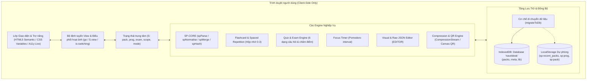
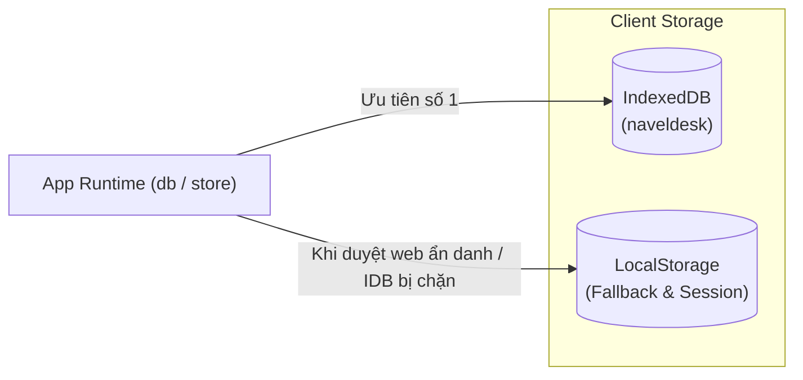
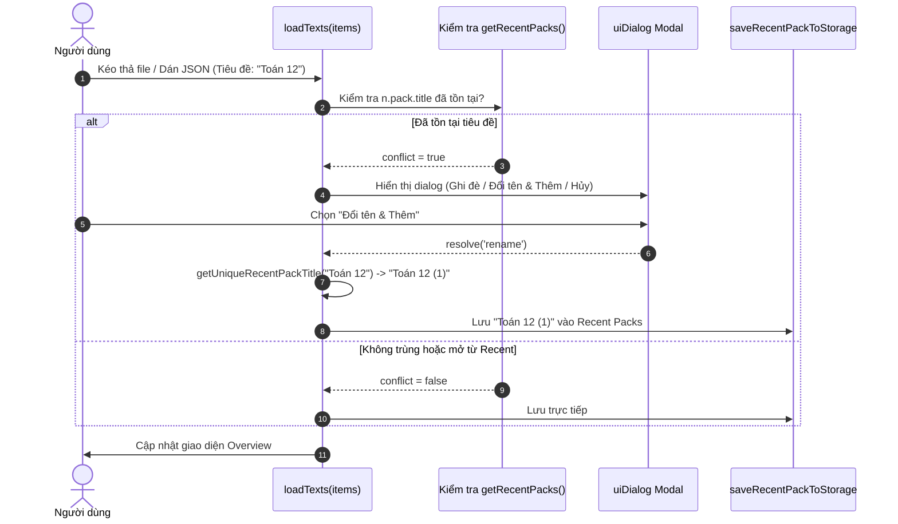

# Tài liệu Kỹ thuật – Navel Desk Architecture & Implementation

Tài liệu này mô tả chi tiết kiến trúc phần mềm, cấu trúc dữ liệu, cơ chế lưu trữ và quy trình hoạt động nội bộ của ứng dụng **Navel Desk** (file nguồn: `bleeding_edge.html`).

---

## 1. Triết lý thiết kế & Tổng quan kiến trúc

### 1.1. Triết lý cốt lõi
- **Single-File Architecture (Kiến trúc một file duy nhất)**: Toàn bộ cấu trúc giao diện (HTML5), bảng kiểu dáng (CSS3) và logic nghiệp vụ (Vanilla JavaScript) được tích hợp trọn vẹn trong một file HTML duy nhất (~8.600 dòng code).
- **Zero-Dependency (Không phụ thuộc thư viện ngoài)**:
  - Không sử dụng framework frontend (không React, Vue, Angular).
  - Không qua bước biên dịch hoặc đóng gói (no Webpack, Vite, Babel, npm build).
  - Không phụ thuộc runtime bên thứ ba (chỉ tải 3 font chữ từ Google Fonts: Plus Jakarta Sans, Lora, JetBrains Mono; nếu offline sẽ tự rơi về font hệ thống tương đương).
- **Local-First & Offline-First (Ưu tiên dữ liệu cục bộ & ngoại tuyến)**:
  - Toàn bộ dữ liệu, tiến độ học, lịch sử làm bài và các gói bài học được lưu trữ trực tiếp trên trình duyệt của người dùng thông qua IndexedDB và LocalStorage.
  - Ứng dụng không duy trì backend máy chủ riêng để thu thập dữ liệu; mọi tính năng (kể cả tạo mã QR, nén dữ liệu, xuất/nhập sao lưu, tính điểm) đều được xử lý 100% tại client.

### 1.2. Sơ đồ khối tổng thể (System Architecture)



---

## 2. Cấu trúc tổ chức của tệp nguồn (`bleeding_edge.html`)

Tệp nguồn được phân bổ tuần tự theo các khu vực chức năng:

| Khu vực | Phạm vi dòng (ước lượng) | Mô tả chức năng |
|---|---|---|
| `<head>` | 1 – 28 | Khai báo metadata, viewport, PWA manifest (data URI), icon SVG inline, nạp web fonts. |
| `<style>` | 29 – 1600 | Hệ thống Design System tokens (`:root`), typography fluid (`clamp`), CSS layout (Grid/Flexbox), component styles, theme light/dark, bản vá WebKit/iOS. |
| `<body>` (DOM tĩnh) | 1601 – 1905 | Các landmark cơ bản: `.skip-link`, `#rail` (thanh điều hướng bên), `<main id="main">`, `#timerPanel`, `#debugPopup`, modal thông báo trợ năng `#a11yLive`. |
| `<script id="promptText">` | 1780 – 1900 | Nội dung prompt mẫu chuẩn hóa (tiếng Anh) dùng để hướng dẫn AI chuyển đổi tài liệu Word thành Study Pack JSON. |
| `I18N` Object | 1907 – 2730 | Từ điển song ngữ Anh (`en`) và Việt (`vi`), hỗ trợ biến nội suy `{key}` và dạng số nhiều `[dạng 1, dạng nhiều]`. |
| `SP-CORE` | 2731 – 2990 | Lõi thuần túy (pure functions): phân tích cú pháp, chuẩn hóa schema, gộp gói, băm chuỗi. |
| App Runtime & Storage | 2991 – 5050 | Quản lý IndexedDB (`db`), LocalStorage (`store`), nạp file (`loadTexts`), điều hướng (`go`), xử lý dialog (`uiDialog`). |
| View Renderers | 5051 – 6260 | Các hàm kết xuất HTML: Overview, Flashcards, Quiz, Mock Exam, Progress Backup, Settings. |
| `EDITOR` Module | 6261 – 6910 | Module tự quản (IIFE): Soạn thảo trực quan, cây gói con (Subpacks), auto-expanding textarea, soạn thảo JSON thô. |
| `LB` & `SH` Modules | 6911 – 8300 | Thư viện môn học ngoại tuyến (`LB`), nén chuỗi Base64 và vẽ mã QR thuần (`SH`). |
| Event Listeners & Boot | 8301 – 8650 | Lắng nghe sự kiện click tập trung (`[data-act]`, `[data-go]`), phím tắt, `boot()` khởi chạy hệ thống. |

---

## 3. Mô hình dữ liệu & Quy chuẩn Study Pack (`SP-CORE`)

### 3.1. Cấu trúc chuẩn của một Study Pack JSON
Mỗi gói bài học là một đối tượng JSON tuân thủ schema phiên bản 1:

```json
{
  "format": "studypack",
  "version": 1,
  "id": "optional-unique-slug",
  "title": "Tên bộ ôn tập",
  "subject": "Môn học (ví dụ: Lịch sử)",
  "level": "Cấp độ (ví dụ: Lớp 12)",
  "language": "vi",
  "packs": [ /* danh sách gói con (subpacks) lồng nhau, tối đa 3 cấp */ ],
  "topics": [
    {
      "id": "t1",
      "title": "Tiêu đề chủ đề",
      "summary": "Tóm tắt ngắn gọn",
      "notes": [
        {
          "heading": "Tiêu đề mục ghi chú",
          "points": ["Ý chính 1 có chứa **từ khóa quan trọng**", "Ý chính 2"]
        }
      ],
      "key_terms": [
        { "term": "Thuật ngữ", "definition": "Định nghĩa chi tiết" }
      ],
      "flashcards": [
        { "front": "Mặt trước thẻ (Câu hỏi/Khái niệm)", "back": "Mặt sau (Câu trả lời/Ý nghĩa)" }
      ],
      "questions": [
        {
          "type": "mcq",
          "prompt": "Nội dung câu hỏi trắc nghiệm?",
          "options": ["Phương án A", "Phương án B", "Phương án C", "Phương án D"],
          "answer": 0,
          "explanation": "Giải thích vì sao A đúng."
        }
      ]
    }
  ]
}
```

### 3.2. Quy trình xử lý dữ liệu đầu vào
Hệ thống xử lý tệp qua 4 hàm thuần túy (pure functions) độc lập:

1. **`spParse(text)`**:
   - Loại bỏ ký tự BOM (`\uFEFF`) ở đầu chuỗi.
   - Bóc tách mã Markdown code fences (nhận diện mẫu ` ```json ... ``` ` hoặc ` ``` ... ``` `).
   - Tự tìm vị trí dấu ngoặc nhọn đầu tiên `{` và cuối cùng `}` để trích xuất JSON hợp lệ nếu văn bản bị dính lời dẫn của AI.
2. **`spNormalise(data)`**:
   - Kiểm tra định dạng cấu trúc, xử lý tương thích ngược: tự ánh xạ `terms` thành `key_terms`, `cards` thành `flashcards`, `t`/`a` trong `tfs` thành `text`/`answer`.
   - Lọc bỏ các mục hỏng hoặc thiếu trường bắt buộc một cách êm ái (non-destructive): thay vì dừng cả chương trình, hàm lưu lại danh sách `warnings` và `errors` dạng mã i18n kèm tham số (`{ key, vars }`) để hiển thị thông báo cho người dùng.
3. **`spMerge(packs)`**:
   - Cho phép nạp đồng thời nhiều tệp lẻ (ví dụ: chia theo từng chương `chuong1.json`, `chuong2.json`).
   - Tự động gộp danh sách các chủ đề (`topics`) và gói con (`packs`), gắn định danh tự sinh để tránh xung đột id giữa các tệp.
4. **`spHash(str)`**:
   - Hàm băm chuỗi DJB2 cải tiến, tạo ra chuỗi hash an toàn dài 8 ký tự base36 để gắn kết dữ liệu bài học với khóa tiến độ học trong cơ sở dữ liệu (`sp:prog:<hash>`).

---

## 4. Tầng lưu trữ dữ liệu (Storage Layer)

### 4.1. Kiến trúc lưu trữ kép (Hybrid IndexedDB + LocalStorage)
Để xử lý được các bộ dữ liệu lớn (chứa hàng trăm câu hỏi và ghi chú) mà không bị giới hạn 5MB của LocalStorage, ứng dụng sử dụng kiến trúc lưu trữ lai:



- **Database IndexedDB**: Tên DB `naveldesk`, phiên bản `1`.
  - Object Store `packs`: Lưu các bộ bài học gần đây (`{ id, title, text, updatedAt }`).
  - Object Store `meta`: Lưu gói đang mở hiện tại (`key: 'current'`), cờ di chuyển dữ liệu (`key: 'migrated'`).
  - Object Store `lib`: Lưu trữ nội dung các môn học cài từ thư viện ngoại tuyến.
- **LocalStorage Fallback**: Đối tượng bọc `store` xử lý an toàn toàn bộ thao tác `getItem`, `setItem`, `removeItem` với khối `try...catch` nhằm phòng ngừa lỗi hạn ngạch (`QuotaExceededError`) hoặc duyệt web ở chế độ riêng tư (Private Browsing).

### 4.2. Cơ chế di chuyển dữ liệu tự động (`migrateToDb`)
Khi ứng dụng khởi động lần đầu trên trình duyệt có hỗ trợ IndexedDB:
1. Đọc danh sách gói cũ từ khóa LocalStorage `sp:recent_packs`.
2. Ghi hàng loạt vào bảng `packs` của IndexedDB bằng `db.packsBatch(recs, [])`.
3. Đọc ngược lại từ IndexedDB để kiểm tra tính toàn vẹn (checksum so sánh độ dài và thuộc tính từng gói).
4. Chỉ khi dữ liệu đã toàn vẹn 100%, cờ `migrated = 1` mới được ghi nhận.

### 4.3. Quản lý 100 bộ học gần đây & Giải quyết xung đột trùng lặp
- Danh sách **Recent Packs** lưu tối đa 100 bộ ôn tập đã mở gần nhất, hỗ trợ tìm kiếm trực tiếp trên thanh tìm kiếm (`#rpQ`).
- Khi người dùng nạp một bộ bài học mới (`loadTexts`), hàm sẽ kiểm tra tiêu đề trùng lặp:
  - Nếu trùng tiêu đề với bộ đã có trong Recent Packs: Kích hoạt dialog xác nhận gồm 3 nhánh:
    - **Hủy (Cancel)**: Không nạp và không lưu.
    - **Ghi đè (Overwrite)**: Cập nhật nội dung mới lên bộ bài học cũ có cùng tiêu đề.
    - **Đổi tên & Thêm (Rename & Add)**: Kích hoạt hàm thuật toán `getUniqueRecentPackTitle(title)`. Hàm sẽ bóc tách đuôi số thứ tự dạng ` (1)`, ` (2)`... và tự động tăng dần lên chỉ số chưa từng tồn tại, sau đó cập nhật thuộc tính `title` trong cả đối tượng JSON rồi lưu song song vào cơ sở dữ liệu.



---

## 5. Quản lý trạng thái & Chu kỳ kết xuất (State Management & UI Pipeline)

### 5.1. Đối tượng trạng thái trung tâm (`S`)
Ứng dụng quản lý toàn bộ giao diện bằng đối tượng đơn nhất (single source of truth) `S`:
- `S.view`: Tên màn hình đang hiển thị (`'overview'`, `'study'`, `'exam'`, `'load'`, `'edit'`, `'settings'`, `'library'`, `'credits'`).
- `S.pack`: Đối tượng dữ liệu của bộ bài học đang được nạp.
- `S.scope`: Phạm vi học tập hiện tại (toàn bộ gói `'all'` hoặc id của chủ đề cụ thể).
- `S.mode`: Chế độ hiển thị trong chủ đề (`'notes'`, `'cards'`, `'quiz'`).
- `S.prog`: Tiến độ học của bộ hiện tại (các mục ghi chú đã đọc, hộp nhớ của từng thẻ, điểm quiz cao nhất, lịch sử làm bài).
- `S.exam`: Trạng thái đề thi thử hiện tại (danh sách câu hỏi đã chọn ngẫu nhiên, câu trả lời, thời gian còn lại, cờ đánh dấu).

### 5.2. Chu kỳ chuyển view & Hoạt ảnh chuyển cảnh
Hàm điều hướng `go(where, id, mode)` kiểm soát quá trình chuyển đổi giữa các màn hình:
1. **Active-View Guard**: Bỏ qua thao tác nếu người dùng bấm vào chính view đang hiển thị.
2. **Transition Lock**: Kiểm tra cờ `.is-switching` trên thẻ `<main id="main">`. Nếu đang trong quá trình chuyển cảnh thì ngăn chặn các lượt nhấp lặp lại.
3. **Phân rã DOM & Glide Animation**: Thêm class `.is-switching` để kích hoạt hiệu ứng mờ dần (opacity fade), đặt `setTimeout(..., 180)` để thay đổi `S.view`, gọi `render()`, cuộn về đỉnh trang (`window.scrollTo(0, 0)`), sau đó qua hai nhịp `requestAnimationFrame` để gỡ bỏ class chuyển cảnh, tạo hiệu ứng mượt mà (smooth glide).

### 5.3. Trình tạo phần tử DOM nhẹ (`h`) & Hệ thống Modal Promise (`uiDialog`)
- **Hàm `h(tag, attrs, ...children)`**: Được sử dụng trong toàn bộ module Editor để thay thế JSX hoặc virtual DOM nặng nề. Hỗ trợ gán thuộc tính HTML, class, sự kiện `on*` và chèn phần tử con tự động.
- **Hệ thống `uiDialog(o)`**: Thay thế hoàn toàn các hàm đồng bộ chặn luồng của trình duyệt (`window.alert`, `window.confirm`, `window.prompt`):
  - Trả về một `Promise`.
  - Sử dụng thẻ ngữ nghĩa HTML5 `<dialog class="ui-dlg">` cùng phương thức `showModal()`.
  - Hỗ trợ mảng hành động đa nút (`actions: [{ key, label, primary, cls }]`), tự động bắt phím `Enter` trong ô nhập và phím `Esc` để hủy.

---

## 6. Chi tiết các Engine chức năng chuyên sâu

### 6.1. Flashcard & Thuật toán lặp lại ngắt quãng (Spaced Repetition)
- Hệ thống quản lý thẻ dựa trên mô hình hộp nhớ Leitner thu gọn gồm 4 cấp độ:
  - **Hộp 0 (Chưa học)**: Mặc định của mọi thẻ mới.
  - **Hộp 1 (Mới học)**: Thẻ đã lật xem ít nhất 1 lần.
  - **Hộp 2 (Đang nhớ)**: Thẻ trả lời đúng nhưng cần ôn lại để củng cố.
  - **Hộp 3 (Đã thuộc)**: Thẻ đã ghi nhớ vững vàng.
- Khi người dùng đánh giá thẻ:
  - Nếu chọn *Chưa thuộc / Not yet*: Thẻ bị đưa về **Hộp 1**.
  - Nếu chọn *Đã thuộc / Had it*: Thẻ thăng cấp từ từ lên **Hộp 2** và **Hộp 3**.
- **Chỉ số Sẵn sàng ôn thi (Topic Readiness)**:
  $$\text{Readiness} = \frac{\text{Tỷ lệ đọc ghi chú} + \text{Tỷ lệ thẻ thuộc (Hộp 3)} + (\text{Điểm Quiz tốt nhất} / 100)}{3}$$

### 6.2. Câu hỏi & Cơ chế chấm điểm tự động (Quiz Engine)
Hệ thống hỗ trợ 6 dạng câu hỏi với bộ thẩm định riêng biệt:

| Dạng mã | Tên dạng | Cách thức tương tác & Chấm điểm |
|---|---|---|
| `mcq` | Trắc nghiệm | Chọn 1 trong các phương án (2–6 lựa chọn). Đáp án lưu dạng chỉ số 0-based index. |
| `truefalse` | Đúng / Sai | 2 nút lựa chọn Đúng/Sai, lưu dạng boolean (`true`/`false`). |
| `tfs` | Đúng / Sai nhiều ý | Gồm 1 đoạn trích dẫn và đúng 4 nhận định độc lập. Chấm điểm theo chuẩn bậc thang: Đúng 1 câu = 0.1đ; 2 câu = 0.25đ; 3 câu = 0.5đ; 4 câu = 1.0đ. |
| `cloze` | Điền khuyết | Chứa vị trí trống `____`. Chuỗi nhập vào được chuẩn hóa bằng regex (loại bỏ dấu câu, chuyển chữ thường, đối soát linh hoạt bảng dấu tiếng Việt). |
| `match` | Nối cặp | Hai cột thực thể, chọn cặp trái - phải. Điểm số = $\frac{\text{Số cặp ghép đúng}}{\text{Tổng số cặp}}$. |
| `short` | Tự luận ngắn | Người học tự nhập suy nghĩ của mình, sau đó bấm mở đáp án mẫu để tự so sánh và tự đánh giá điểm. |

### 6.3. Thi thử (Mock Exam Runner)
- Trình tạo đề ngẫu nhiên từ kho câu hỏi của các chủ đề được chọn.
- Quản lý đồng hồ đếm ngược có cảnh báo khi sắp hết giờ.
- Cơ chế chống mất bài thi: Trạng thái đang thi (danh sách câu hỏi đã chọn ngẫu nhiên, các đáp án đã chọn, cờ đánh dấu câu hỏi) được tự động đồng bộ liên tục vào khóa `sp:run:<packKey>`. Nếu người học vô tình tắt tab hoặc tải lại trang, hệ thống sẽ nhận diện và đưa ra thông báo tiếp tục bài thi đang dở dang.

### 6.4. Bộ soạn thảo tích hợp (`EDITOR`)
Module `EDITOR` cung cấp 2 chế độ làm việc:
1. **Chế độ GUI trực quan**:
   - Quản lý cây bài học (Pack Hierarchy) hỗ trợ phân cấp gói con lồng nhau tới 3 tầng.
   - Cơ chế tự động co giãn ô nhập văn bản đa dòng (`textarea.ag`):
     - Hàm `grow(el)` tính toán `scrollHeight` thực tế và đặt lại thuộc tính `style.height`.
     - Hàm `growAll()` kích hoạt đo đạc thông qua `requestAnimationFrame` kết hợp các khoảng hoãn (60ms, 250ms) để chờ phông chữ và bố cục CSS render ổn định.
     - Lắng nghe sự kiện `window.addEventListener('resize')` để tự động tính lại chiều cao khi co giãn cửa sổ trình duyệt.
2. **Chế độ Text (Raw JSON)**:
   - Hiển thị toàn bộ dữ liệu dưới dạng JSON có thụt lề 2 khoảng trắng.
   - Bắt lỗi cú pháp thời gian thực, hiển thị thông báo lỗi chi tiết mà không làm sập ứng dụng.

### 6.5. Engine Nén & Chia sẻ không cần máy chủ (`SH`)
- **Nén chuỗi chia sẻ**: Dữ liệu gói học được chuyển thành JSON, sau đó nén nhị phân trực tiếp bằng luồng nén chuẩn của trình duyệt `CompressionStream('deflate-raw')`.
- **Mã hóa URL**: Chuỗi nhị phân nén được bọc sang định dạng `Base64URL` an toàn, tạo thành URL chia sẻ dạng `#share=z<compressed_data>`.
- **Mã QR trực tiếp (Embedded Canvas QR)**: Không gọi API bên thứ ba, tích hợp thuật toán sinh ma trận mã QR nhị phân thuần bằng JavaScript (`qrcodegen`) và vẽ trực tiếp lên thẻ `<canvas>`.

---

## 7. Hệ thống thiết kế (Design System) & Khả năng trợ năng (A11y)

### 7.1. Bảng mã màu & Tokens (`:root`)
Toàn bộ giao diện được token hóa thông qua CSS Custom Properties:
- **Màu nền & Bề mặt**: `--bg` (nền trang), `--surface` (nền thẻ card), `--line` (viền ngăn cách).
- **Màu chữ**: `--ink` (màu chữ chính), `--muted` (màu phụ/ghi chú).
- **Màu điểm nhấn**: `--accent`, `--accent-hover`, `--accent-soft` (nền nhạt làm nổi bật).
- **Khoảng cách linh hoạt**: `--sp-xs` (4px), `--sp-sm` (8px), `--sp-md` (16px), `--sp-lg` (24px), `--sp-xl` (32px).
- **Bán kính góc bo**: `--rad-sm` (6px), `--rad-md` (10px), `--rad-lg` (16px), `--rad-pill` (9999px).
- **Typography Fluid**: Sử dụng hàm `clamp()` tính toán kích thước theo độ rộng màn hình (ví dụ: `--text-2xl: clamp(1.4rem, 1.15rem + 1.25vw, 1.85rem)`).

### 7.2. Hỗ trợ Accessibility (A11y) theo chuẩn WCAG
- **Cấu trúc ngữ nghĩa**: Sử dụng thẻ `<main id="main">`, `<aside class="ed-side">`, `<nav class="rail">`, `<dialog>`.
- **Vùng cập nhật động cho Screen Reader**: Phần tử ẩn `#a11yLive` với thuộc tính `aria-live="polite"` và `aria-atomic="true"` tự động nhận thông điệp qua hàm `announceA11y(text)` mỗi khi người dùng hoàn thành một hành động hoặc lật thẻ.
- **Điều hướng phím tắt**:
  - Phím `Space` hoặc `Enter`: Lật thẻ ghi nhớ.
  - Phím `1`, `2`, `3`: Đánh giá mức độ thuộc thẻ.
  - Phím `S`: Gắn sao hoặc bỏ gắn sao thẻ bài.
  - Phím `Esc`: Đóng toàn bộ các modal hoặc thanh menu đang mở.

---

## 8. Hướng dẫn phát triển, kiểm thử & Đóng góp mã nguồn

### 8.1. Môi trường chạy thử
Do kiến trúc không phụ thuộc build tool, bạn có thể chạy thử mã nguồn bằng bất kỳ giải pháp web server tĩnh nào:
```bash
# Sử dụng Python có sẵn trên máy:
python -m http.server 8000

# Hoặc sử dụng Node.js:
npx serve .
```
Sau đó truy cập: `http://localhost:8000/bleeding_edge.html`.

### 8.2. Kiểm tra cú pháp JavaScript
Trước khi lưu và commit, hãy kiểm tra toàn bộ các khối script inline trong tệp HTML thông qua Node.js:
```bash
python scratch/check_scripts.py
```
*(Script này sẽ bóc tách toàn bộ các thẻ `<script>` không phải `text/plain` và chạy `node --check` để đảm bảo không có lỗi cú pháp syntax).*

### 8.3. Chạy bộ kiểm thử tự động với Chrome DevTools Protocol
Dự án có sẵn bộ test tự động điều khiển trình duyệt Headless Chrome không phụ thuộc framework kiểm thử bên ngoài:
```bash
# Kiểm tra toàn diện giao diện, lưu trữ, thi thử và bộ soạn thảo:
node scratch/auto_test_devtools.mjs

# Kiểm tra cơ chế tự co giãn Title, khoảng cách nút gói con và dialog xung đột trùng lặp:
node scratch/test_editor_and_import_conflict.mjs
```
Các kết quả kiểm thử và ảnh chụp màn hình (screenshots) sẽ được ghi nhận tự động vào thư mục `scratch/screenshots/`.
